# Next.js Bilingual E-commerce

[](https://github.com/Maatify/nextjs-bilingual-ecommerce/actions/workflows/ci.yml)

**A complete English / Arabic (RTL) e-commerce storefront and admin dashboard built with Next.js 16. Bilingual by design and adaptable to other markets (see [Adapting it to your market](#adapting-it-to-your-market)): cash on delivery, configurable shipping zones, offers, moderated reviews and a full bilingual back office.**

**Live demo:** [vedra.showcase.maatify.dev](https://vedra.showcase.maatify.dev/) (English) · [Arabic](https://vedra.showcase.maatify.dev/ar) (العربية). The demo resets on every deploy; orders placed there are not fulfilled.

**Google PageSpeed Insights, home page of the live demo (lab data): Performance 98 · Accessibility 100 · Best Practices 100 · SEO 100, on both mobile and desktop.** [Details and per-page results](#audit-results).

The demo store sells apparel (heavyweight hoodies, sweatshirts, tees, sweatpants and shorts). It is built for shoppers arriving from paid social on their phones: they land on a product, pick a colour and size, see the offer, and order with cash on delivery in a few taps, in English or Arabic.

This README covers what the store does, the decisions behind it (SEO, conversion, UX, UI, performance, accessibility, security), the measured audit results including where it still falls short, and how to set it up for your own market.

> **Sample data.** The demo database ships placeholder business details (phone, WhatsApp, email, social links, domain, legal name), sample promo codes and 131 **sample reviews**. They exist to show how the pages look with content; the reviews are not from real customers and none of them carries a "Verified buyer" badge.
>
> **Example market.** The sample data uses Egypt as its example market: 27 regions with their own courier rates and delivery windows, and prices in Egyptian pounds. Shipping zones are edited in the admin and money formatting lives in one function, so the store can be set up for any country. See [Adapting it to your market](#adapting-it-to-your-market).

---

## Contents

- [Screenshots](#screenshots)
- [Features](#features)
- [How it's built to sell](#how-its-built-to-sell)
  - [SEO, GEO and AEO](#seo-geo-and-aeo)
  - [Conversion (CRO)](#conversion-cro)
  - [UX](#ux)
  - [UI and design system](#ui-and-design-system)
  - [Performance](#performance)
  - [Accessibility](#accessibility)
  - [Security](#security)
  - [Quality automation](#quality-automation)
- [Engineering guidelines](#engineering-guidelines)
- [Audit results](#audit-results)
- [Known limitations](#known-limitations)
- [Tech stack](#tech-stack)
- [Getting started](#getting-started)
- [Adapting it to your market](#adapting-it-to-your-market)
- [Deployment](#deployment)
- [Scripts](#scripts)
- [Project structure](#project-structure)
- [About](#about)
- [License](#license)

---

## Screenshots

Key pages in both languages: English on the left, Arabic (right-to-left) on the right. Captured from the local dev server with Playwright at 1440 px (desktop) and 390 px (phone).

### Desktop

| | English | العربية |
|---|---|---|
| Home | 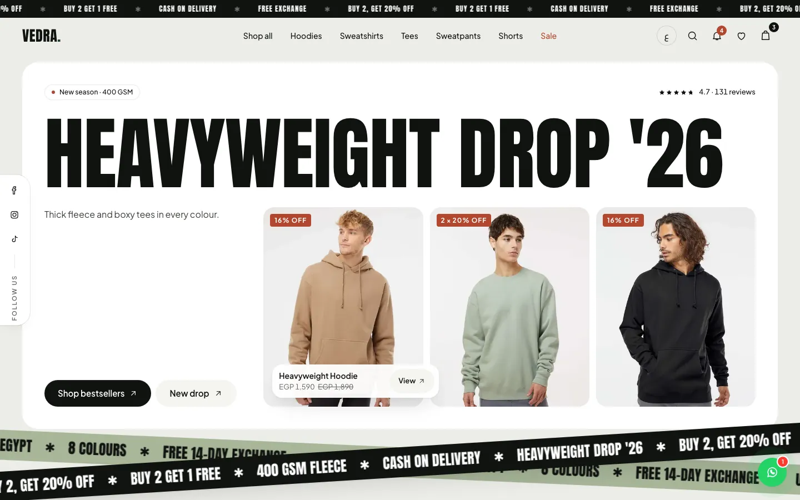 | 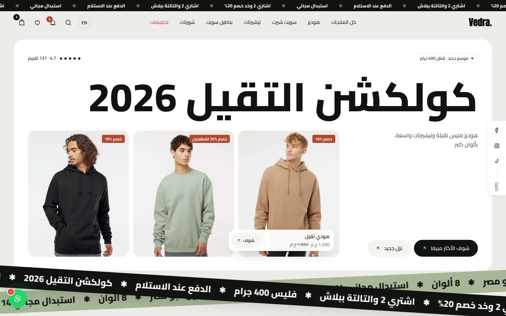 |
| Collection | 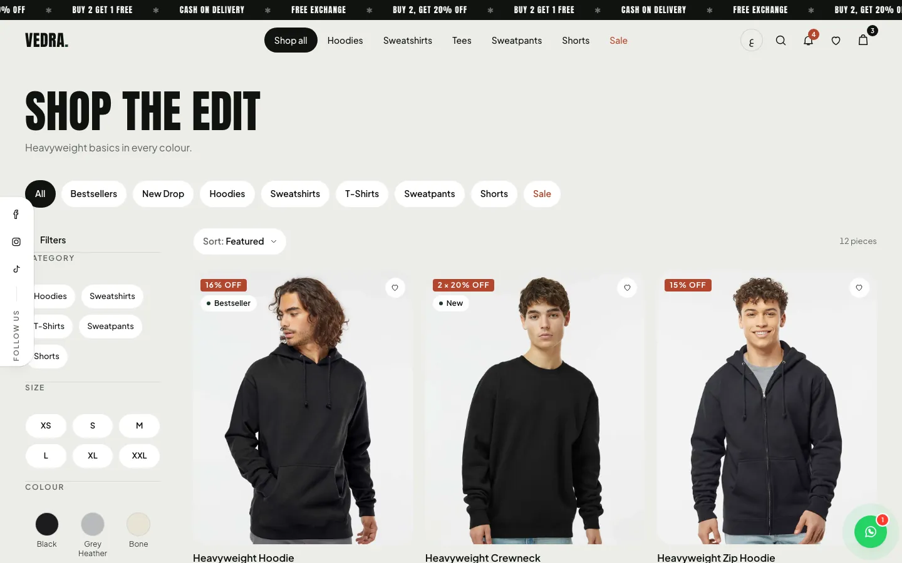 | 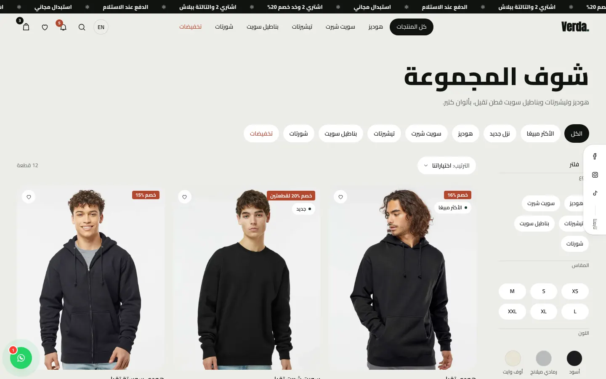 |
| Product | 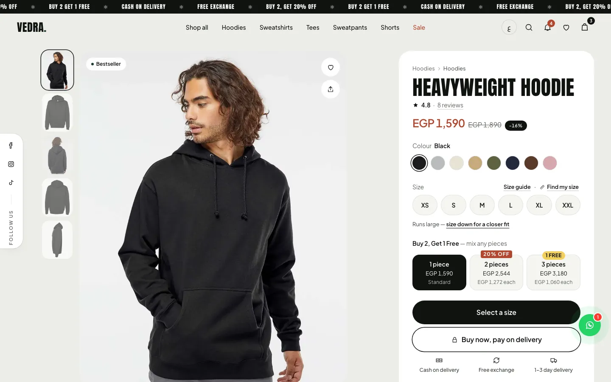 | 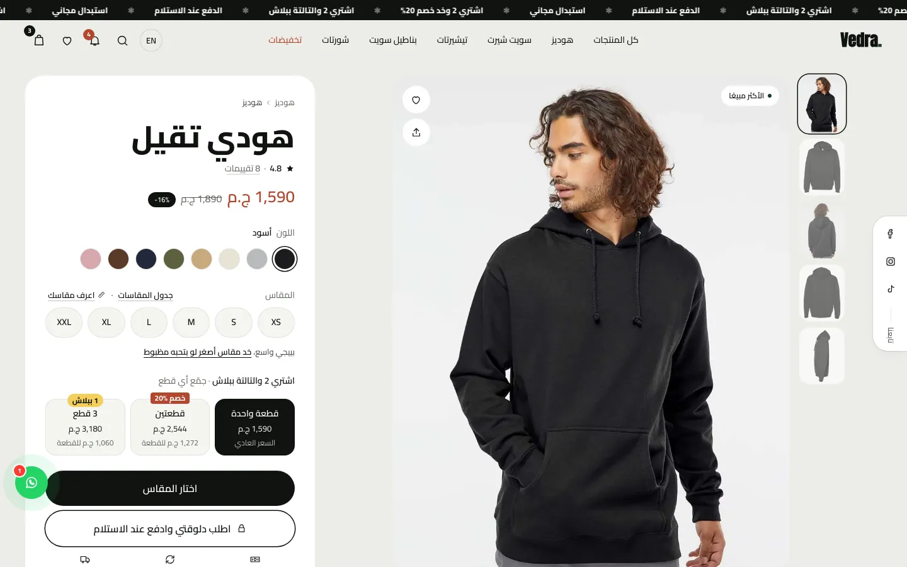 |
| Bag | 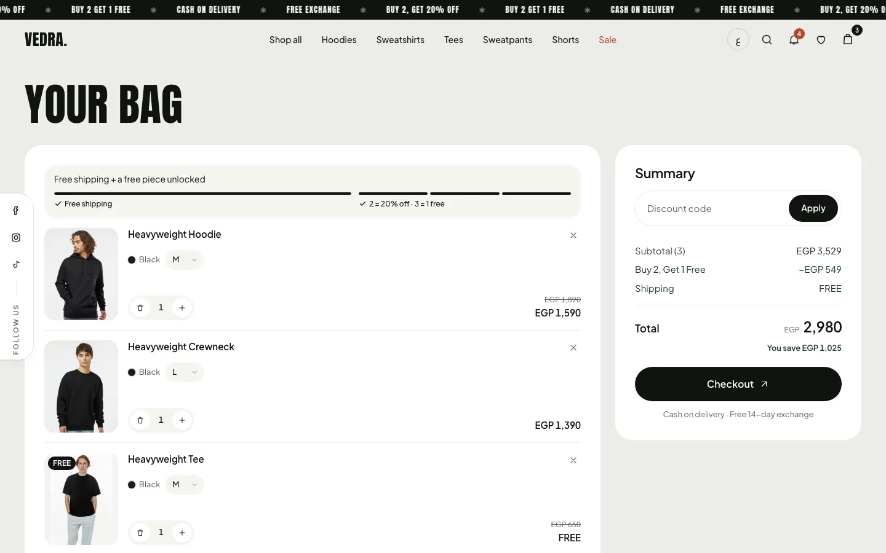 | 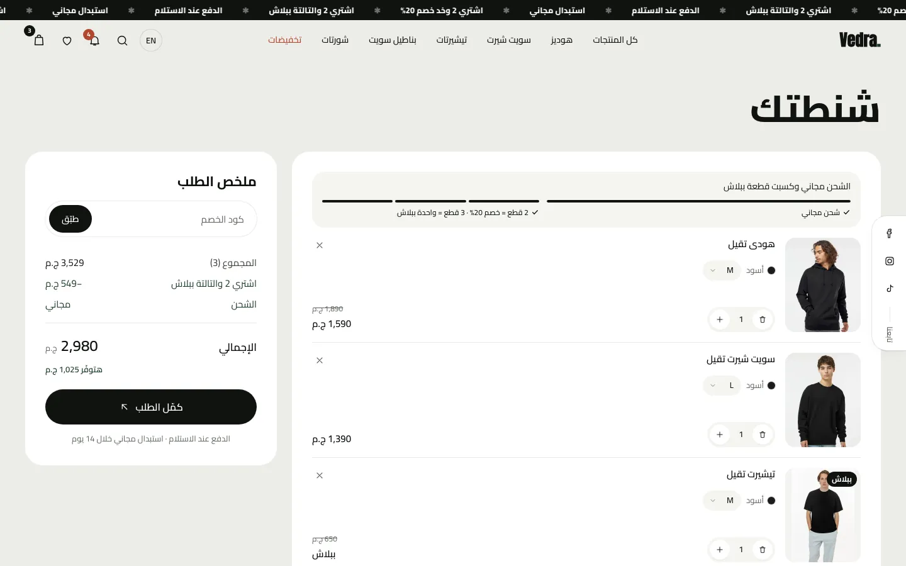 |
| Checkout | 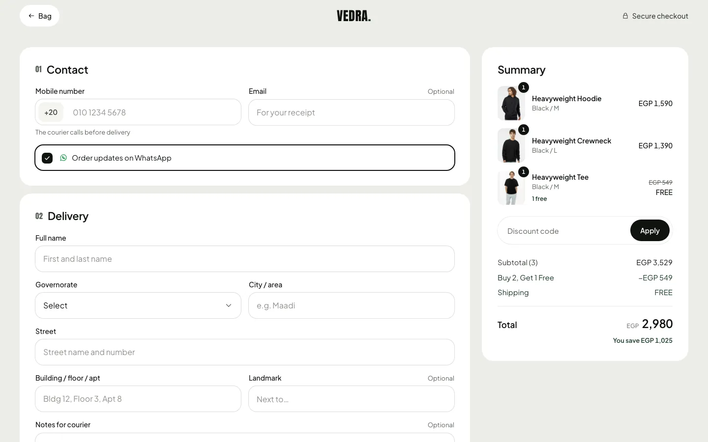 | 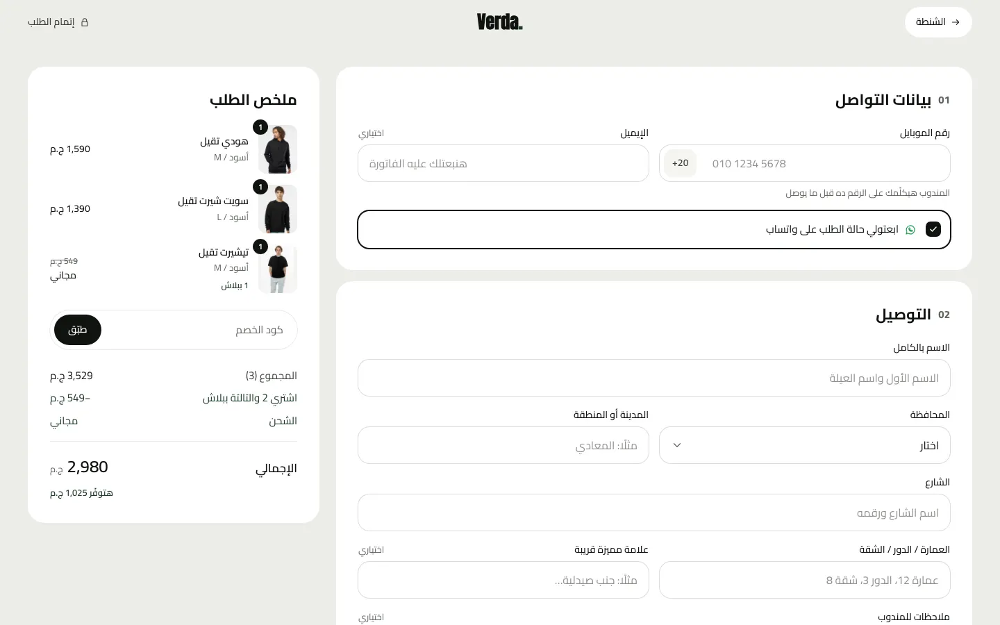 |

### Phone

| Home EN | Home AR | Collection EN | Collection AR |
|---|---|---|---|
| 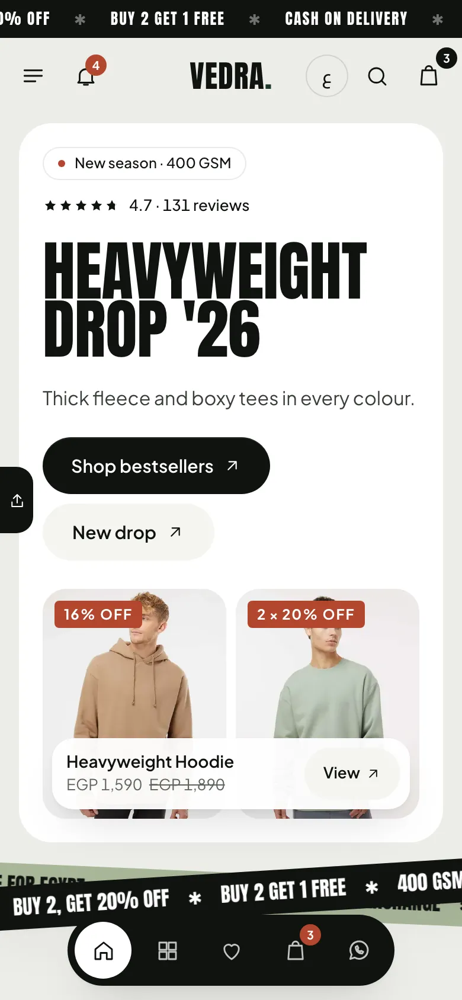 |  | 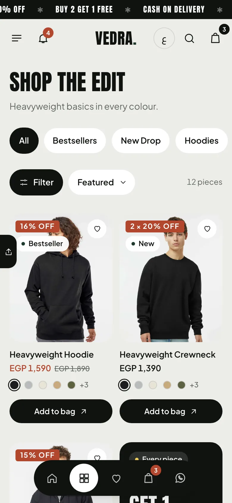 | 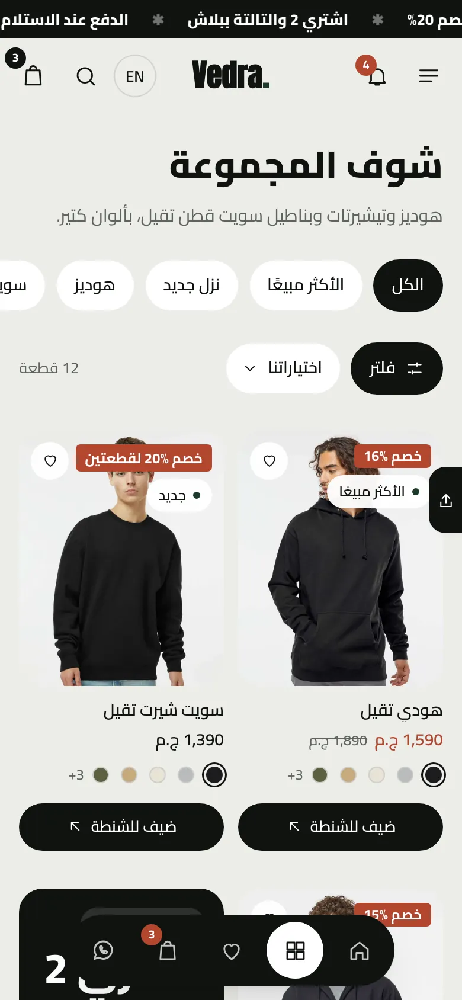 |

| Product EN | Product AR | Bag EN | Bag AR |
|---|---|---|---|
| 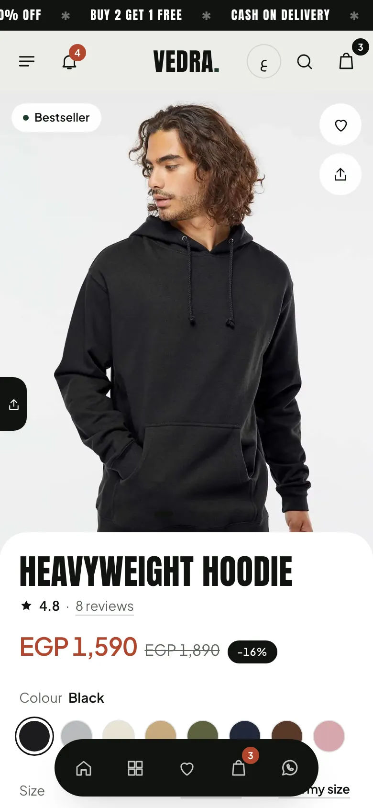 |  | 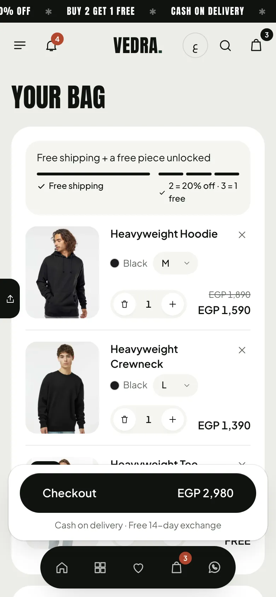 | 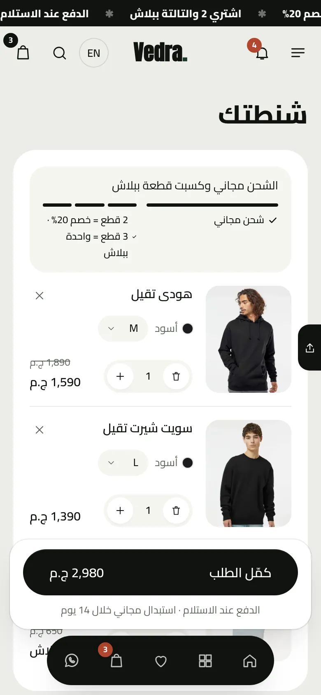 |

| Checkout EN | Checkout AR |
|---|---|
| 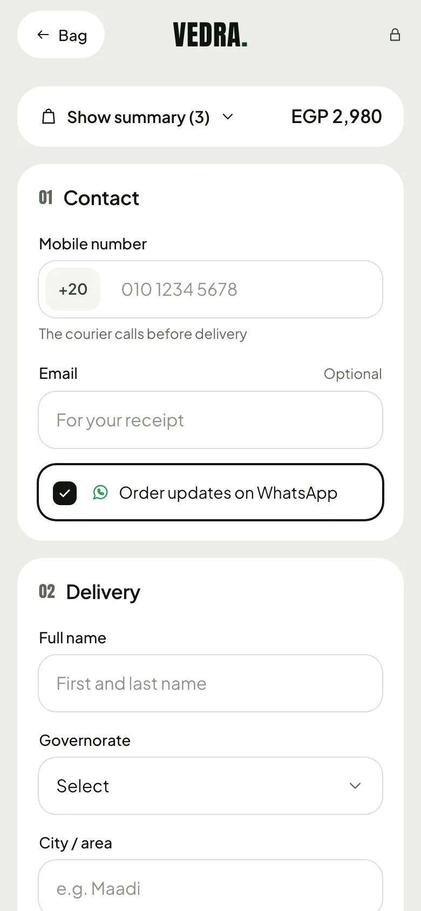 | 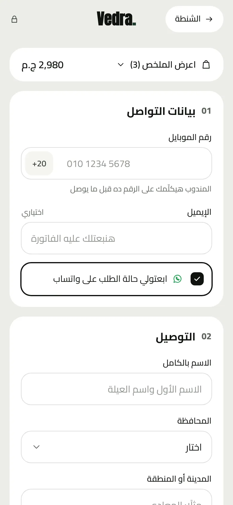 |

---

## Features

### Storefront

| Area | What it does |
|---|---|
| Home | Hero collage of real bestsellers (ranked by sales), offer tapes, trust strip, category tiles, "The Edit" (bestsellers by 24 h sales, then the rest of the catalog), a colour story (one hoodie, every colour, deep-linked to the product), a one-tap matching set (top + sweatpants in the closest colour), reviews and a FAQ block. All sections are editable from the admin. |
| Collections | 9 public collections (plus 3 hidden ones used for navigation rules). Filters for category, size, colour and price band, six sort orders (featured, bestselling, newest, price up/down, top rated). Filter state lives in the URL. Offer banner explains Buy 2 Get 1 in one line. |
| Search | Overlay and full `/search` page. Matches English **and** Arabic fields whatever the page language, handles plurals, Arabic dialect and English synonyms, Arabic letter normalisation (tashkeel, alef/yeh forms) and typos up to 2 edits ("hodie", "sweetpants"). Shows popular terms and recently viewed products. |
| Wishlist | Heart on every card and product page, saved locally, "move to bag" with a size picker. |
| Recently viewed | Kept locally, shown in search. |
| Content pages | About, Shipping, Returns, Size guide, FAQ, Contact (with a form), Privacy, Terms. All edited in the admin with a rich-text editor. |
| Order tracking | `/track-order`: order number + mobile number shows a status timeline (placed, confirmed, packed, with courier, delivered). |
| Ad landing pages | `/lp/[handle]`: a "no cart" cash-on-delivery page per product for ad traffic (pick colour, size and quantity offer, fill five fields, done). `noindex`, canonical points to the product page. |
| WhatsApp | Floating chat button (in the tab bar on phones), "Ask on WhatsApp" on product questions, order confirmation and order questions prefilled with the order number. |
| Offers inbox | A bell in the header listing the offers that are currently switched on in Settings (Buy 2 Get 1, multi-buy %, free shipping, welcome code). |
| Newsletter + welcome offer | Email or mobile number. The welcome pop-up fires on exit intent (desktop) or after a delay / 60% scroll (mobile), at most once every 3 days, never on checkout and never for shoppers who already have items in the bag. |
| Recent-purchase toast | Built from **real orders the store has confirmed in the last 48 h only** (first name, region, product). Pending, cancelled, returned and demo orders are never shown. Shows nothing when there are none. Max 3 per session, never on checkout or product pages. |
| Phone navigation | Bottom tab bar (home, collections, wishlist, bag, WhatsApp), slide-in menu, bag drawer. |
| Share images | Generated Open Graph images per product and per language. |

### Product page

| Feature | Notes |
|---|---|
| Gallery | Thumbnails on desktop, swipe carousel on phones, full-screen zoom viewer, share button, wishlist. Follows the selected colour. |
| Colour × size variants | Stock and price are tracked per colour × size. Sold-out sizes are disabled and offer "notify me" (email or WhatsApp). "Only N left" appears only when real stock is 3 or less. |
| Find my size | Height, weight, menswear / womenswear and fit preference → a recommended size, mapped onto the product's size chart and adjusted for the style's fit tendency (from review fit feedback). Includes the size chart and how-to-measure notes, cm/kg or in. |
| Fit note | "Runs small, size up" / "true to size" / "runs large", from the product's fit setting and review stats. |
| Quantity offers | Cards for 1 piece, 2 pieces (multi-buy %), 3 pieces (Buy 2 Get 1), with the real total per tier from the pricing engine. |
| Two CTAs | "Add to bag" and "Buy now, pay on delivery" (adds and goes straight to checkout). |
| Sticky add-to-bag | Appears once the main button scrolls out of view, with its own size sheet. |
| Complete the set | Hoodie or crewneck ⇄ sweatpants, tee ⇄ shorts, in the matching colour. One tap when the size is already chosen. |
| Details | Description (rich text), fabric & fit, care, shipping & returns. |
| Questions | Admin-managed Q&A, server-rendered, with a WhatsApp button. |
| Reviews | See [Reviews](#reviews). |
| Ad deep links | `?color=&size=&qty=` preselects the variant and quantity tier, so an ad can link to "black, size M, 3 pieces". |

### Bag and checkout

| Feature | Notes |
|---|---|
| Bag drawer + `/cart` page | Change size or quantity per line, remove, see which units are free. Saved in `localStorage` and synced across tabs. |
| Rewards meter | Progress to free shipping and to the next free piece, worded from the live offer settings. |
| Cross-sells | "Others also bought": the matching-set piece for what's in the bag first, with one-tap add. |
| Distraction-free checkout | Separate layout (no header menu, no pop-ups). Mobile number first, email optional, WhatsApp updates opt-in. |
| Address form | Region select (the demo data ships with Egypt's 27 governorates), each with its own courier rate and delivery window (e.g. 1–2 business days for the capital region, 5–7 for the most remote one). City, street, building/floor/apt, landmark, courier notes. |
| Shipping options | Standard per region, optional express / next-day delivery for selected regions (switchable in Settings). Free over a threshold. |
| Payment | **Cash on delivery** ("open and check, then pay"). The checkout also contains card, wallet and installments options, but they stay hidden until a payment gateway is connected (see [Known limitations](#known-limitations)). |
| Promo codes | Validated on the server with clear errors (unknown code, minimum subtotal). |
| Order bump + shipping protection | Optional checkout-only add-on product at a discount and an optional protection fee, both switchable in Settings. |
| Abandoned checkout | Once a valid phone or email is typed, the bag is saved. The admin can send a WhatsApp message with a restore link (`/cart?restore=…`) that refills the bag. |
| Thank-you page | Order summary, delivery estimate, "Confirm on WhatsApp" button, and a post-purchase "add to this order" offer (20% off one extra piece, same parcel, only within 30 minutes and while the order is still pending, re-priced on the server). |
| Validation | Mobile number format (the demo checks Egyptian mobile numbers), inline field errors, clear messages when the store can't be reached. |

### Offers and pricing

All money logic lives in one file, [`src/lib/pricing.ts`](src/lib/pricing.ts), shared by the product page, bag, checkout and the order API, and covered by unit tests.

| Rule | Default in the demo data (editable in Admin → Discounts & offers / Settings) |
|---|---|
| Buy N Get M | Buy 2, get 1 free. The cheapest unit in every group of 3 is free. Mix any products, colours and sizes. Repeats every 3 pieces. |
| Multi-buy % | 2 pieces → 20% off. Applies to pieces left over after full Buy 2 Get 1 groups (5 pieces = one free + 20% off the other two). |
| Free shipping | From EGP 1,500 after discounts. |
| Shipping | Per-region rate (EGP 65 to 130 in the seed data). |
| Free gift | Canvas tote over EGP 3,500. |
| Promo codes | Percentage or fixed amount, optional minimum subtotal, active flag, usage count. |
| Prepaid discount | A percentage for online payment methods. It only applies to a method backed by a connected payment gateway, so it is inactive in this repository. |
| Variant prices | A colour × size can override the product price and compare-at price. |

The server never trusts client totals: `POST /api/orders` re-validates every line, re-checks stock, rejects payment methods that aren't available and re-prices the whole order before saving.

### Reviews

- Product reviews with star distribution, fit stats ("x% say true to size"), height/weight/size bought, up to 3 photos per review, store replies, "Verified buyer" badges and source labels (via Instagram, WhatsApp, Google, TikTok).
- **Every review is moderated** before it appears. Nothing on the storefront is generated: ratings, counts and JSON-LD are computed from published reviews only.
- Ways to collect real reviews: an open "Write a review" form; **personal review links** sent on WhatsApp after an order is marked delivered (`/review/<token>`, 128-bit token stored only as a SHA-256 hash, single use, 60-day expiry); and a **CSV import** for reviews collected elsewhere (Instagram DMs, Google, etc.).
- "Verified buyer" is only set for reviews sent from a personal review link, or from the form when the reviewer's phone number matches an order for that product (or when the owner ticks it on a review entered by hand in the admin). Imported reviews and the demo's sample reviews are never marked verified.
- Optional review reward (discount code after publication). Rewarded reviews are labelled on the page, and the reward never depends on the rating.
- Review photos are sniffed by magic bytes, decoded and re-encoded to WebP, which strips EXIF/GPS data.
- The demo database's reviews are flagged as sample data and can be removed in one click (Admin → Backup → clear demo data).

### Bilingual and RTL

| Topic | How |
|---|---|
| URLs | English at unprefixed URLs (`/products/x`), Arabic under `/ar` (`/ar/products/x`). Every page exists in both. |
| Language routing | [`src/proxy.ts`](src/proxy.ts): first visit with an Arabic-first browser goes to `/ar`; after that a language cookie (set by the language switcher or by opening an `/ar` link) wins. Crawlers and link-preview bots always get the URL they asked for, so both languages stay indexable. The storefront stays fully static (rewrites hit prerendered pages). |
| Direction | `<html lang dir>` per locale, logical CSS properties, mirrored layout, mirrored marquee direction. |
| Copy | Separate dictionaries per area (`src/lib/i18n/store/messages/*`) with a type that forces the Arabic file to mirror every English key. Arabic plural rules (zero/one/two/few/many). The demo's Arabic copy is written in plain, conversational Arabic (Egyptian dialect), not translated word for word. |
| Numbers | Western digits in both languages (the common convention in Arabic e-commerce), `EGP 1,590` / `1,590 ج.م` in the demo. Phone numbers, order numbers and codes are wrapped so they don't reorder inside Arabic text. |
| Fonts | Cairo for Arabic, loaded only on Arabic pages; English visitors never download it. |
| Catalog content | Product, collection and page content is stored in both languages and edited in the admin. |
| Admin | The dashboard itself is bilingual (EN / AR) with its own dictionaries. |

### Admin dashboard (`/admin`)

A full back office, password protected, bilingual, light / dark / system theme, `⌘K` / `Ctrl+K` command search and keyboard shortcuts (`G` then `O` for orders, etc.).

| Section | What you can do |
|---|---|
| Home | KPIs for today / 7 / 30 / 90 days / all time with comparison to the previous period (revenue, orders, average order value, items per order, returning customers, cash-on-delivery share), charts by hour or day, "needs attention" (orders to confirm, low stock, reviews to moderate, codes near their limit), top products, sales by region, a setup guide. |
| Orders | List with filters and search, order detail with status timeline, printable invoice, CSV export, draft (manual) orders, abandoned checkouts with a WhatsApp restore link. Live notifier for new orders. |
| Products | Product editor with colour × size variants (stock and price per variant), colour-specific media, rich-text description, SEO fields per language, live preview. Categories, tags, and an inventory grid with bulk adjust. |
| Customers | Customer list and detail, grouped by phone number, with their order history. |
| Messages | Inbox for the contact form. |
| Reviews | Moderate, reply, hide, collect via WhatsApp links, CSV import, reward settings. |
| Discounts & offers | Buy N Get M, multi-buy %, free-shipping threshold, gift, promo codes. |
| Content | Homepage sections, navigation menus, CMS pages, FAQ, media library. |
| Analytics | Sales analytics over time. |
| Settings | Store details, shipping (region rates and delivery windows, express), payments, checkout options, **Security** (change password, TOTP two-factor auth with recovery codes, list and revoke active sessions). |
| Activity log | Who changed what, including sign-in failures. |
| Backup | Export the whole store as JSON, restore from a backup (a safety copy is written first), clear demo data. |

Every admin write goes through a server action that logs the change and revalidates the affected storefront pages, so edits show up on the static storefront without a rebuild.

---

## How it's built to sell

### SEO, GEO and AEO

**Technical**

- Every product, collection, page and the home page is **statically prerendered** in both languages (`next build` generates 88 pages on a fresh checkout), so the title, price, description, `<h1>` and JSON-LD are in the server HTML.
- **One `<h1>` per page**, unique titles (≤ 60 characters) and meta descriptions (≤ 155). Product descriptions are generated from real data (price, compare-at price, rating, stock) and trimmed to stay under 155 characters; merchant-written SEO text always wins.
- **Canonical URLs** and **hreflang** (`en`, `ar`, `x-default`) on every indexable page.
- **`noindex`** on cart, checkout, thank-you, search, wishlist, track order, ad landing pages and review links.
- **`robots.txt`** ([`src/app/robots.ts`](src/app/robots.ts)) keeps private and per-visitor paths out of the crawl in both languages, and blocks collection filter URLs (`/collections/*?`), which are client-side views of the same page. Product `?color=` links stay crawlable because they are the variant offer URLs in the JSON-LD.
- **`sitemap.xml`** ([`src/app/sitemap.ts`](src/app/sitemap.ts)) is data-driven: one URL per language for every product, visible collection and content page (60 URLs with the demo catalog), real `lastModified` from product edits (no fake dates), hreflang alternates and image entries. Refreshed hourly and on every admin write.
- Real **404 status** for unknown products and pages.
- One source for the site URL (`NEXT_PUBLIC_SITE_URL`); no hardcoded domains.
- Open Graph and Twitter cards with generated per-product share images.

**Structured data** ([`src/lib/seo.ts`](src/lib/seo.ts)), built from the same data the page renders:

| Schema | Where |
|---|---|
| `OnlineStore` (Organization) with contact points and `sameAs` | Every page |
| `WebSite` + `SearchAction` | Home |
| `ProductGroup` → `Product` per variant → `Offer` (price, availability, strikethrough price, `OfferShippingDetails`, `MerchantReturnPolicy`) + `AggregateRating` and `Review` from published reviews | Product pages |
| `BreadcrumbList` | Product and collection pages |
| `ItemList` | Collections |
| `FAQPage` | FAQ blocks |

**GEO / AEO (AI search and answer engines)**

- AI search crawlers (OAI-SearchBot, ChatGPT-User, Claude-SearchBot, PerplexityBot, etc.) are explicitly allowed, with no crawl delay. Training crawlers (GPTBot, ClaudeBot, Google-Extended) are allowed too; the owner can remove them in one line.
- [`/llms.txt`](src/app/llms.txt/route.ts) gives answer engines a plain Markdown summary of the store, collections, products, live offers and policy pages, built from live data.
- FAQ answers are short and self-contained, so a passage can be quoted on its own.
- Content lives in the server HTML, not behind client JavaScript.

### Conversion (CRO)

The store is designed around the doubts a shopper arriving from Instagram or TikTok has before ordering from a store they don't know yet.

| Doubt | Answer in the UI |
|---|---|
| "Can I trust them with my money?" | Cash on delivery is the default and is repeated where it matters: product page badges, bag, checkout ("open and check, then pay"). Free 14-day size exchange in the demo policy. |
| "Will it fit?" | Find my size, per-product size chart, fit note from reviews, and the exchange policy next to the size picker. |
| "Is this a good deal?" | Offers are shown as real totals per quantity tier, not vague percentages. The bag shows which units are free and the total saved. |
| "When will it arrive, and what does shipping cost?" | Per-region rate and delivery window in checkout, free-shipping progress in the bag. |
| "Can I ask someone?" | WhatsApp on every page and in product Q&A. |

**Urgency only when it's true.** "Only N left" comes from real variant stock. The recent-purchase toast reads real, confirmed orders from the last 48 hours and stays silent when there are none. There are no fake countdown timers and no invented visitor counts.

**Less friction**

- Two CTAs on the product page, including "Buy now, pay on delivery" straight to checkout.
- Sticky add-to-bag on scroll, with its own size sheet.
- Checkout asks for the mobile number first; email is optional. No account needed.
- Checkout has its own layout with no menu, pop-ups or social links.
- Ad deep links preselect colour, size and quantity; ad landing pages take the order on the same page.
- Bag persists across reloads and tabs; abandoned checkouts can be recovered with a WhatsApp restore link.

**Average order value**

- Buy 2 Get 1 and multi-buy % shown as quantity cards on the product page.
- "Complete the set" on the product page, matching-set builder on home, cross-sells in the bag.
- Rewards meter (free shipping, next free piece, gift).
- Optional order bump in checkout and a post-purchase "add to this order" offer.

### UX

- **Mobile first**: bottom tab bar, bag drawer, swipe gallery, size sheet, large tap targets.
- **Bilingual by URL**, with the choice remembered. The language switcher keeps you on the same page.
- **No layout shift** when the bag loads: the checkout waits for the saved bag before rendering, so there is no empty-bag flash.
- **Search that forgives**: typos, plurals, Arabic or English, dialect synonyms.
- **Helpful empty and error states**: empty bag and wishlist point to bestsellers, the 404 page has search, the error page is bilingual.
- **Clear errors in plain language**, in the shopper's language, from both the form and the server.
- **Order tracking without an account**, using order number + phone.

### UI and design system

- **Tailwind CSS 4** with tokens defined in `@theme` ([`src/app/globals.css`](src/app/globals.css)): a warm off-white background, near-black ink, forest and sage greens, an amber accent and a single sale red. Shared radii, shadows and easing curves.
- **Type**: Anton for display headings, Plus Jakarta Sans for UI and body, Instrument Serif for accents, Cairo for all Arabic text. Admin uses Geist, which is never preloaded on the storefront.
- **Motion** with the `motion` library and CSS, transform and opacity only: an opening curtain on full page loads, page transitions, a slow announcement marquee that pauses on hover, a pointer-depth hero collage. All of it respects `prefers-reduced-motion`.
- **Separate storefront and admin stylesheets**, so shoppers don't download the admin's CSS (storefront CSS went from 190 KB to 115 KB raw, verified pixel-identical before and after).

### Performance

What was done:

- Static prerendering for every storefront page in both languages; language routing via rewrites so pages stay static.
- `next/image` everywhere with a custom loader, `sizes` per layout and a trimmed `deviceSizes` list. The LCP image on product and collection pages is preloaded with `fetchPriority="high"` and is in the initial HTML; everything below the fold is lazy.
- Catalog photos are WebP (594 files, 8.8 MB in total) compressed by [`scripts/optimize-images.mjs`](scripts/optimize-images.mjs) with an **SSIMULACRA2 ≥ 90 quality gate**: quality is raised until the result is visually lossless, and the original is kept if the result isn't smaller.
- Catalog photos are cached 30 days with `stale-while-revalidate`.
- Fonts via `next/font` with `display: swap`; the Arabic font only loads on Arabic pages.
- No third-party scripts at all.
- Footer links don't prefetch (about 15 fewer prefetch requests per page).
- bfcache-friendly (no `unload` listeners, HTML not `no-store`).
- CSS inlining was tested and left off: no measurable gain, and it would add about 20 KB gzipped to every HTML response.

Results are in [Audit results](#audit-results). In short: Google PageSpeed Insights scores the live demo's home page 98 for performance on mobile and on desktop. In the local Lighthouse 13.6 audit the home, cart and checkout score 98–100 on mobile, every page scores 98–100 on desktop, and the **product and collection pages score 85–86 on mobile**. Under Lighthouse's simulated slow 4G, the first product photo (40 KB, preloaded) competes with about 280 KB of gzipped JavaScript, about 105 KB of fonts and the next gallery images on one throttled link, so LCP lands at 4.1–4.3 s. In real Chrome the same pages paint in 0.3–0.7 s. Fixing the lab score means fewer font files or deferring gallery slides, which would visibly change the store, so it is left as an open item.

### Accessibility

- **Lighthouse accessibility 100** on every measured page, mobile and desktop.
- **axe-core** (WCAG 2.1 A/AA) runs on key pages in both languages in `npm run test:site` and fails the run on any serious or critical issue.
- Semantic landmarks, a skip link, one `<h1>` per page, labelled controls (every icon button has an accessible name, sizes announce "sold out" or "only N left"), `<details>`-based disclosures for Q&A, focus-visible styles, keyboard-usable dialogs and sheets.
- `prefers-reduced-motion` turns animations into short fades or static content.
- Tested for horizontal overflow from 280 px to 3840 px wide in both languages (0 overflow in 1,392 page loads during the audit; CI repeats a smaller sweep on every run).

### Security

**Headers** ([`next.config.ts`](next.config.ts)): Content-Security-Policy (`default-src 'self'`, `object-src 'none'`, `frame-ancestors 'none'`, `base-uri 'self'`, forms may only post to the site or `wa.me`, `upgrade-insecure-requests`), `X-Content-Type-Options`, `Referrer-Policy`, `Permissions-Policy`, `X-Frame-Options: DENY`, `Cross-Origin-Opener-Policy`, HSTS in production, no `X-Powered-By`. `script-src` keeps `'unsafe-inline'` on purpose: a per-request nonce would force every page to render dynamically and give up static/CDN caching. The trade-off is documented in the config.

**Admin**

- Edge guard in [`src/proxy.ts`](src/proxy.ts) (no session cookie → login or 401) plus real validation server-side in every admin page, action and route.
- Password stored as an **scrypt** hash (bootstrapped once from `ADMIN_PASSWORD`, then changed in the dashboard); strength meter with a minimum length of 10.
- **Server-side sessions** with hashed tokens, 12 h idle and 7 day absolute timeout, `__Host-` cookies over HTTPS, list and revoke sessions.
- **TOTP two-factor auth** (RFC 6238) with replay protection and 8 single-use recovery codes.
- **Sign-in throttling** that survives restarts: per IP (5 free failures, then exponential lockout up to 1 h) and global (catches distributed guessing, capped low so the owner can't be locked out for long).
- Admin and admin API responses are `no-store` and `noindex`.

**Public API**

- **Rate limits** persisted in SQLite on every public endpoint (e.g. orders 20 / 10 min per IP, reviews 4 / 30 min, contact 5 / 10 min, promo checks 12 / 10 min). Client IP is read from a configurable number of trusted proxy hops (`TRUST_PROXY_HOPS`).
- **Honeypot** fields on forms, **body size limits**, cross-site POSTs refused via Fetch Metadata / `Origin`.
- **Orders**: re-validated and re-priced on the server, stock checked, unavailable payment methods rejected, **idempotency keys** so a double tap never creates two orders.
- **Rich text** from the admin is rendered through an allowlist sanitizer.
- **Uploads** are checked by magic bytes, size-limited, decoded and re-encoded (metadata stripped).
- The recent-purchase feed only ever exposes first name, region, product and time.
- The deploy snapshot script strips orders, customers, messages, sessions, password hashes and security tables before anything is published.

**Tested** (see [Audit results](#audit-results)): 150/150 active security tests (also run in CI), `npm audit` (production) 0, semgrep 1 accepted finding, nuclei 0, gitleaks clean, 0 CSP violations across 1,392 page loads.

### Quality automation

| Layer | Tool | What it checks |
|---|---|---|
| Pre-commit | husky + lint-staged | ESLint (0 warnings allowed on staged files) and the TypeScript check |
| Static | `npm run lint`, `npm run typecheck` | ESLint (Next config); `next typegen` (route types) + TypeScript strict |
| Unit | `npm test` (Node test runner) | 20 tests: pricing (Buy 2 Get 1, multi-buy, promo rules, shipping tiers, prepaid discount, variant prices, unknown products, bundle tiers, money formatting in both languages), payment methods (cash on delivery only without a gateway, no prepaid discount) and the recent-purchase feed (confirmed, non-demo orders only) |
| Smoke | `npm run test:smoke` | home → collection → product → add to bag → cart total, with zero console errors and failed requests |
| Site check | `npm run test:site` | SEO basics on every key page in EN + AR (200, title, description, canonical, one h1, valid JSON-LD), real 404, axe-core accessibility, first-load JS budget (≤ 300 KB gz), image budget (≤ 300 KB each) |
| E2E | `npm run test:e2e` (Playwright) | Full purchase flow (order submit mocked, nothing stored) and a layout sweep (11 widths from 280 to 3840 px, no horizontal scroll, one h1) on Chromium, Firefox, WebKit, iPhone 13, Pixel 7, iPad |
| Security | `npm run security:check` | `npm audit` (production) + 150 active tests (XSS, injection, price/qty tampering, IDOR, CSRF, open redirect, uploads, rate limits, admin authorization and middleware-bypass headers, login lockout) |
| Performance | `npm run lighthouse` (Lighthouse CI) | Mobile budgets on `/`, a collection, a product and the bag: accessibility ≥ 0.95, best practices ≥ 0.95, SEO = 1 on indexable pages and CLS ≤ 0.1 fail the run; performance fails below 0.75 and warns below the 0.9 target |
| All-in-one | `npm run check` | lint + typecheck + unit tests + production build |
| CI | [`.github/workflows/ci.yml`](.github/workflows/ci.yml) | Runs all of the above on every PR and push to `main` against a fresh production build with throwaway credentials |

The Lighthouse CI performance gate is set below the 0.9 target on purpose: `@lhci/cli` 0.15 bundles Lighthouse 12.6, whose older LCP model scores these pages lower than Lighthouse 13 and PageSpeed Insights do (see [Audit results](#audit-results)). Results under 0.9 show up as warnings in the CI log instead of hiding the other checks.

---

## Engineering guidelines

The rules every change in this repository follows (design tokens, motion, accessibility, images, performance and the pre-merge checklist) are in [docs/ENGINEERING_GUIDELINES.md](docs/ENGINEERING_GUIDELINES.md).

---

## Audit results

### Google PageSpeed Insights (live demo, home page)

Run by the owner on 2026-11-03 against the home page of the live demo deployment. These are PageSpeed Insights **lab** results (Lighthouse); there is no field (real-user) data for the demo yet.

| | Performance | Accessibility | Best Practices | SEO | Agentic Browsing |
|---|---|---|---|---|---|
| Mobile | **98** | **100** | **100** | **100** | 3/3 |
| Desktop | **98** | **100** | **100** | **100** | 3/3 |

| Mobile | Desktop |
|---|---|
| 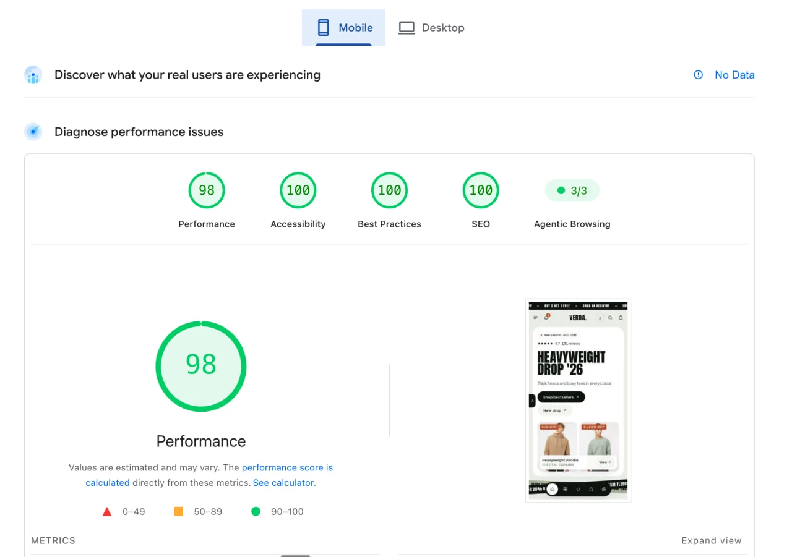 | 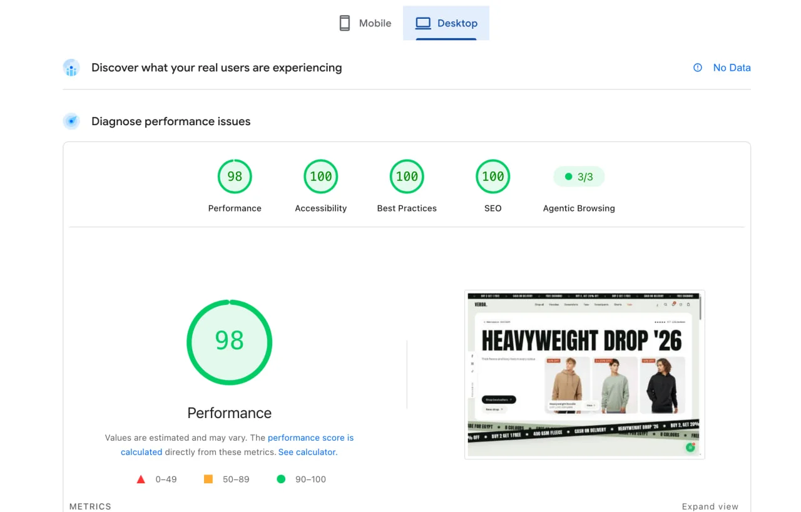 |

### Lighthouse 13.6, every key page (local production build)

From the code audit on 2026-11-03 (median of 3 runs, `next start`). Full details: [`AUDIT_REPORT.md`](AUDIT_REPORT.md).

| Page | Mobile | Desktop |
|---|---|---|
| `/` | **98** · LCP 1.5 s | **100** · LCP 0.4 s |
| `/collections/all` | **86** · LCP 4.1 s | **98** · LCP 1.0 s |
| `/products/heavyweight-hoodie` | **85** · LCP 4.3 s | **99** · LCP 0.9 s |
| `/cart` | **100** · LCP 1.4 s | **100** · LCP 0.4 s |
| `/checkout` | **100** · LCP 1.2 s | **100** · LCP 0.3 s |

Performance score shown. Accessibility 100, Best Practices 100 and SEO 100 on every indexable page. Cart and checkout score 63–66 for SEO because they are `noindex` on purpose. CLS ≤ 0.012 and TBT ≤ 30 ms everywhere.

The Lighthouse CI step in CI uses the Lighthouse 12.6 bundled with `@lhci/cli` 0.15, which scores the same build lower on mobile (a local run on 2026-11-03 gave a median of 86 for `/`, 88 for `/collections/all`, 84 for the product page and 89 for `/cart`, with accessibility and best practices at 100). That is why its performance gate is 0.75 with 0.9 as a warning.

### Cross-browser and cross-device

29 viewport sizes (280 to 3840 px, plus phone landscape) × EN/AR × 8 pages = 464 loads per engine, **1,392 in total**.

| Check | Chromium | Firefox | WebKit |
|---|---|---|---|
| Horizontal page scroll | 0 | 0 | 0 |
| Elements outside the viewport | 0 | 0 | 0 |
| Page or console errors | 0 | 0 | 0 |
| Purchase flow E2E (desktop + iPhone 13 / Pixel 7 / iPad emulation) | pass | pass | pass |

Not covered: real devices, Samsung Internet, Opera, and Instagram / TikTok in-app browsers.

### Security

| Check | Result |
|---|---|
| `npm audit --omit=dev` | 0 vulnerabilities |
| osv-scanner | 0 in production dependencies; dev-only advisories (18 per osv-scanner, 36 per `npm audit`) in ESLint / Lighthouse CI tooling, not shipped |
| semgrep (nextjs, owasp-top-ten, secrets, typescript) | 1 finding, accepted: sanitized `dangerouslySetInnerHTML` for the product description |
| gitleaks | No secrets in source, scripts, tests or `public/` |
| Client bundle grep | No keys, tokens, DB paths or emails |
| Response headers | All present (see [Security](#security)) |
| nuclei (all templates) | 0 findings |
| `scripts/security-tests.mjs --safe` | **150 / 150 pass** |
| OWASP ZAP baseline | Not run |

### Code health

`lint` 0 errors, 0 warnings, `typecheck` 0 errors on a fresh checkout (route types are generated by `next typegen` first), 20/20 unit tests, production build clean (88 pages generated), no `console.log` in `src/`.

---

## Known limitations

Being upfront about what isn't done:

- **No online payment gateway.** Cash on delivery is the only payment flow. The card, wallet and installments options exist in the checkout UI and in Settings, but `gatewayReady()` in [`src/lib/checkout.ts`](src/lib/checkout.ts) keeps them hidden and the order API rejects them until a gateway is integrated; the prepaid discount never applies without one.
- **Placeholder business details** (phone, WhatsApp number, email, social links, domain, legal name) appear in the footer, JSON-LD and `llms.txt`. Replace them in Admin → Settings before real use.
- **Sample data**: 131 sample reviews and sample promo codes (active, without usage limits or end dates) in the demo database. Remove the reviews in Admin → Backup → clear demo data and set up your own codes before launch.
- **Demo data resets**: the [live demo](https://vedra.showcase.maatify.dev/) starts from the `deploy/` snapshot and resets on every deploy, so orders and admin changes made there don't last. See [Deployment](#deployment).
- **Mobile LCP** on product and collection pages (85–86 in Lighthouse 13.6) as explained above.
- Catalog photos are 960 px wide, so they look slightly soft on retina desktops.
- Tailwind 4 needs Safari / iOS 16.4 or newer; older iOS gets degraded styling.
- One admin account (single owner password, no roles).
- Visual regression is checked with screenshot comparisons during audits, but there are no committed screenshot baselines.

Possible extensions, not part of this repository: a payment gateway, ad-platform pixels and conversion APIs, UTM attribution on orders, courier integrations and product feeds.

---

## Tech stack

| | |
|---|---|
| Framework | Next.js 16.4 (App Router, `proxy.ts`, server actions, static generation) |
| UI | React 19.2, Tailwind CSS 4, `motion` |
| Data | SQLite through Node's built-in `node:sqlite` (no ORM, no external database) |
| Images | `next/image` with a custom loader, `sharp` for uploads, share images and the optimization script |
| Testing | Node test runner, Playwright, axe-core, Lighthouse CI |
| Tooling | ESLint 9, TypeScript 5, husky, lint-staged, svgo, SSIMULACRA2 (`calc-s2-rust`) |

Runtime dependencies: `next`, `react`, `react-dom`, `motion` and `sharp`.

---

## Getting started

**Requirements:** Node.js 22 or newer (for `node:sqlite`; 22.18+ for the unit tests, which use Node's built-in TypeScript support) and npm.

```bash
npm install
cp .env.example .env.local   # then fill in the values
npm run dev                  # http://localhost:3000
```

### Environment variables

Names only; see [`.env.example`](.env.example) for comments.

| Variable | Purpose |
|---|---|
| `ADMIN_PASSWORD` | Initial admin password. Used once to create the password hash; after that, change it in Admin → Settings → Security. |
| `ADMIN_INSECURE_COOKIE` | Only for testing a production build over plain `http://localhost` (relaxes the secure admin cookie and, at build time, leaves `upgrade-insecure-requests` out of the CSP). Leave empty in production. |
| `TRUST_PROXY_HOPS` | Number of reverse proxies in front of Next (used to read the real client IP for rate limits). |
| `NEXT_PUBLIC_SITE_URL` | Public site URL for canonical links, sitemap, JSON-LD and share images. |

There is also a recovery flag, `ADMIN_PASSWORD_RESET`, read by the server: set it together with a new `ADMIN_PASSWORD` to reset a lost password (this revokes all sessions and disables 2FA).

### Data

- The store database is a SQLite file in `data/` (git-ignored, together with uploads and backups).
- On first boot it is created and **seeded automatically** with a starter catalog (6 products, 12 collections, 3 of them hidden), settings, shipping rates and content pages. A fresh seed has **no orders and no reviews**. The full demo catalog (12 products) and the sample reviews are in the `deploy/` snapshot.
- [`deploy/`](deploy/) holds a sanitized snapshot made by `npm run db:snapshot`: catalog, content, settings and the 131 sample reviews, with orders, customers, messages, sessions and passwords removed, payments set to cash on delivery only and no review marked verified. On Vercel, the server copies it into the (ephemeral) database path on first start. To see the sample reviews locally, copy it into `data/` before the first run.
- Admin → Backup exports and restores the whole store as JSON.

### Admin

Open `/admin`, sign in with the password from `ADMIN_PASSWORD`, then change it and turn on two-factor auth in Settings → Security.

---

## Adapting it to your market

The store is bilingual (English and Arabic) and not tied to one country, but the demo data and a few defaults use Egypt as the example market. To set it up somewhere else:

| What | Where |
|---|---|
| Store name, contact details, social links, domain, legal name | Admin → Settings → Store details (and `NEXT_PUBLIC_SITE_URL`) |
| Shipping regions, rates and delivery windows | Admin → Settings → Shipping. The seed list (Egypt's 27 governorates) is in [`src/lib/seed/content.ts`](src/lib/seed/content.ts); express delivery is limited to two regions in `expressAvailableFor()` in [`src/lib/checkout.ts`](src/lib/checkout.ts). |
| Currency display | `formatMoney()` in [`src/lib/i18n/store/config.ts`](src/lib/i18n/store/config.ts) prints `EGP 1,590` / `1,590 ج.م`; `intlLocale()` and `ogLocale()` in the same file set the Arabic locale tags. |
| Structured data | [`src/lib/seo.ts`](src/lib/seo.ts) uses the country code `EG` (shipping destination, return policy, area served) and the currency `EGP` in offers and fees. |
| Phone validation and WhatsApp numbers | Egyptian mobile format in `normalizeEgPhone()` in [`src/lib/egypt.ts`](src/lib/egypt.ts), the newsletter form ([`src/components/layout/newsletter-form.tsx`](src/components/layout/newsletter-form.tsx)), the draft-order editor and the admin's `wa.me` helpers ([`src/components/admin/sales/meta.ts`](src/components/admin/sales/meta.ts), [`messages-view.tsx`](src/app/admin/%28panel%29/messages/messages-view.tsx)), plus the matching error messages in the dictionaries. |
| Copy | Storefront dictionaries in `src/lib/i18n/store/messages/*` (the demo's Arabic is Egyptian dialect), admin dictionaries in `src/lib/i18n/admin/*`, page and FAQ content in the admin. |
| Payments | Cash on delivery works out of the box. Online methods need a gateway integration and then `gatewayReady()` in [`src/lib/checkout.ts`](src/lib/checkout.ts). |

These are code-level defaults rather than settings, so changing them is a small code change in the files listed.

---

## Deployment

```bash
npm run build
npm start
```

- **Production**: the store keeps everything (orders, settings, admin password, sessions, rate limits) in the SQLite file in `data/`, so it needs a **persistent disk**: for example a VPS running `npm start` behind a reverse proxy such as nginx, with `TRUST_PROXY_HOPS` set to the number of proxies so rate limits see the real client IP, and `ADMIN_INSECURE_COOKIE` left empty. Back up `data/` regularly. Using an external database instead would mean replacing `src/server/store.ts`.
- **The live demo** at [vedra.showcase.maatify.dev](https://vedra.showcase.maatify.dev/) starts from the `deploy/` snapshot and resets on every deploy; orders placed there are not fulfilled. A real store keeps its SQLite file on persistent storage and backs it up.
- Before taking real orders: replace every placeholder (phone, WhatsApp, email, domain, legal name, social links), clear the sample reviews, review the promo codes, change the admin password and turn on two-factor auth.

---

## Scripts

| Script | What it does |
|---|---|
| `npm run dev` | Dev server |
| `npm run build` / `npm start` | Production build / server |
| `npm run lint` | ESLint |
| `npm run typecheck` | `next typegen && tsc --noEmit` |
| `npm test` | Unit tests (pricing, offers, formatting, payment methods, recent purchases) |
| `npm run check` | lint + typecheck + unit tests + build |
| `npm run test:smoke` | Browser smoke test against a running build (`BASE_URL`) |
| `npm run test:site` | SEO, axe accessibility and JS/image budgets against a running build |
| `npm run test:e2e` | Playwright purchase flow + layout sweep in 6 browser projects (needs a running build) |
| `npm run security:check` | `npm audit` (production) + active security tests in safe mode |
| `npm run lighthouse` | Lighthouse CI with the performance budgets (starts its own server on port 3999) |
| `npm run optimize:images` | Compress images in `public/` with the SSIMULACRA2 quality gate (originals backed up) |
| `npm run db:snapshot` | Write the sanitized database snapshot in `deploy/` for deployment |

The browser-based checks expect a production build already running. To test a production build over plain http, build and start it with `ADMIN_INSECURE_COOKIE=1` (as CI does): `ADMIN_INSECURE_COOKIE=1 npm run build && ADMIN_INSECURE_COOKIE=1 npx next start -p 3000`, then `BASE_URL=http://localhost:3000 npm run test:e2e`. Install the browsers once with `npx playwright install chromium firefox webkit`.

---

## Project structure

```text
src/
├── app/
│   ├── [lang]/                  # storefront, en + ar
│   │   ├── (store)/             # home, collections, products, search, cart, wishlist, pages, track-order
│   │   ├── (checkout)/          # distraction-free checkout + thank-you
│   │   ├── (lp)/lp/[handle]/    # ad landing pages (noindex)
│   │   └── (review)/review/     # personal review links
│   ├── admin/                   # admin dashboard (login + panel)
│   ├── api/                     # orders, checkouts, promo, reviews, contact, subscribe, tracking, recent purchases, admin live feed
│   ├── media/                   # uploaded media
│   ├── sitemap.ts, robots.ts, llms.txt/, manifest.ts
│   └── globals.css, store.css   # design tokens, storefront CSS
├── components/                  # storefront (pdp, cart, checkout, collection, home, layout, lp, reviews, fx) and admin UI
├── lib/
│   ├── pricing.ts               # offers, bundles, shipping, totals (single source of truth)
│   ├── checkout.ts              # checkout pricing, payment methods
│   ├── size.ts                  # size recommender + size charts
│   ├── store.ts                 # bag / wishlist / recently viewed (localStorage)
│   ├── search.ts                # bilingual search with synonyms and typo tolerance
│   ├── seo.ts                   # metadata helpers + JSON-LD
│   ├── i18n/                    # storefront and admin dictionaries
│   └── seed/                    # first-boot catalog and content
├── server/
│   ├── store.ts                 # SQLite store, seed and migrations
│   ├── admin.ts, auth.ts        # admin writes (log + revalidate), auth
│   ├── security/                # sessions, password, 2FA, throttling, rate limits, idempotency
│   └── queries/                 # dashboard and catalog queries
└── proxy.ts                     # language routing + admin edge guard
tests/                           # unit tests + Playwright specs
scripts/                         # smoke, site check, security tests, image optimizer, DB snapshot
deploy/                          # sanitized demo database snapshot
docs/screenshots/                # README images (EN + AR, desktop + phone, PageSpeed Insights)
docs/ENGINEERING_GUIDELINES.md  # build rules and pre-merge checklist
AUDIT_REPORT.md                  # the code audit
LICENSE
```

---

## About

### Maatify

Maatify is a digital solutions company building web apps, e-commerce stores, iOS and Android apps, APIs and open-source libraries.

- **London, United Kingdom** — UK company no. 14781290
- **Giza, Egypt** — Commercial Registration no. 37921 (development team)
- Rated 5.0 on Clutch, GoodFirms, The Manifest and Upwork.
- Clients in 19 countries.

[Website](https://maatify.dev) · [GitHub](https://github.com/Maatify) · [LinkedIn](https://www.linkedin.com/company/maatify/) · [X](https://x.com/maatify) · [Instagram](https://www.instagram.com/maatify) · [Facebook](https://www.facebook.com/maatify.dev/)

### Built by

**Ahmed Fawzy**, Co-Founder & Front-end Team Leader, Maatify · Cairo, Egypt

He leads client projects end to end, from scope and pricing to delivery, building fast, bilingual (Arabic/English) e-commerce stores, web apps and mobile apps for brands in Egypt, the Gulf and the UK.

[LinkedIn](https://www.linkedin.com/in/ahmed-fawzy-maatify) · [Website](https://maatify.dev) · [a.fawzy@maatify.com](mailto:a.fawzy@maatify.com)

---

## License

© 2026 Maatify. All rights reserved. The source is available for viewing only; see [LICENSE](LICENSE). Product photos, brand name and copy in the demo are not licensed for reuse.
